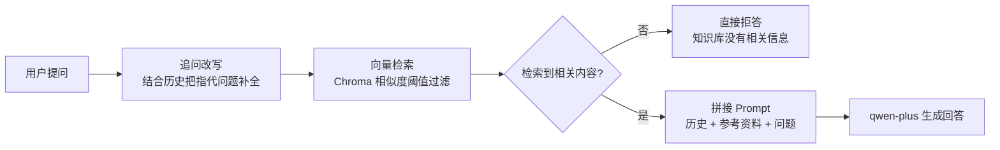
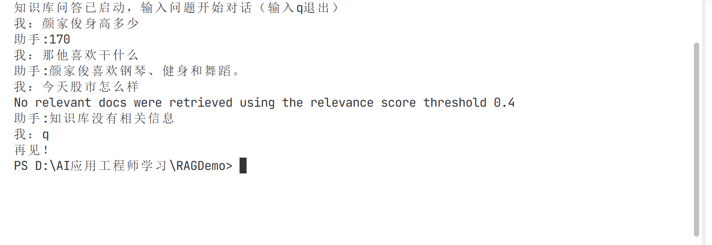

# RAGDemo:本地知识库智能问答系统

基于LangChain + Chroma + 通义千问的RAG（检索增强生成）实战项目：把本地文档变成可对话知识库，支持语义检索，抗幻觉拒答和多轮对话记忆。

## 功能特性

- **离线建库**：本地文档自动分块、向量化并持久化到Chroma，二次启动直接加载，无需重复embedding
- **抗幻觉双闸门**：相似度阈值硬过滤（similarity_score_threshold）+Prompt拒答指令软闸门，知识库没有的内容直接拒答，不编造
- **多轮对话记忆**：支持“那他喜欢干什么”这类指代追问——先把追问改写成完整问题（condense question），再检索回答
- **幂等加载**：启动时自动检测向量数据库是否已经存在，避免重复入库导致检索结果被重复副本霸榜

## 技术栈

| 组件 | 选型 |
| --- | --- |
| LLM | 通义千问 qwen-plus（阿里云百炼 OpenAI 兼容接口） |
| Embedding | text-embedding-v3（1024维） |
| 向量数据库 | Chroma(本地持久化) |
| 编排框架 | LangChain(LCEL管道) |

## RAG工作流程



## 快速开始

**1. 克隆仓库**

```bash
git clone https://github.com/sheep-white/RAGDemo.git
cd RAGDemo
```

**2. 安装依赖**（建议使用虚拟环境）

```bash
pip install -r requirements.txt
```

**3. 配置密钥**：在项目根目录新建 `.env` 文件，填入以下内容（替换成你自己的 key）：
```
OPENAI_API_KEY=你的阿里云百炼API-KEY

OPENAI_API_BASE=https://dashscope.aliyuncs.com/compatible-mode/v1 

OPENAI_MODEL=qwen-plus
```

**4. 准备知识库**：编辑 `knowledge.txt`，放入你的文档内容。

**5. 运行**

```bash
python my_rag.py
```
启动后输入问题即可对话，输入 `q` 退出

## 使用效果



演示包含三种情况：库内问题正常回答 → "那他喜欢干什么"指代追问通过 condense 改写命中知识库 → 库外问题（股市）触发阈值拒答。

## 技术亮点 / 踩坑记录

- **阿里云 embedding 接口 400**：兼容接口不认 tiktoken 本地预分词的 token 数组，需设置 `check_embedding_ctx_length=False` 直接传原始字符串
- **Chroma 分数方向**：Chroma 返回的是距离（越小越相关），框架内相关性 = 1 - 距离/√2，阈值 0.4 约对应距离 0.85
- **重复入库污染检索**：同一内容多个副本会霸榜 Top-K，因此用 `os.path.exists` 做幂等加载
- **记忆救不了检索端**：历史只拼进生成 Prompt，指代追问在检索端依然失败，所以需要独立的 condense 改写链先补全问题再检索